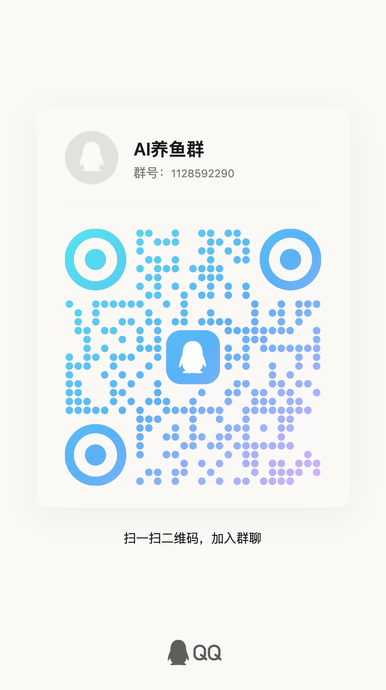
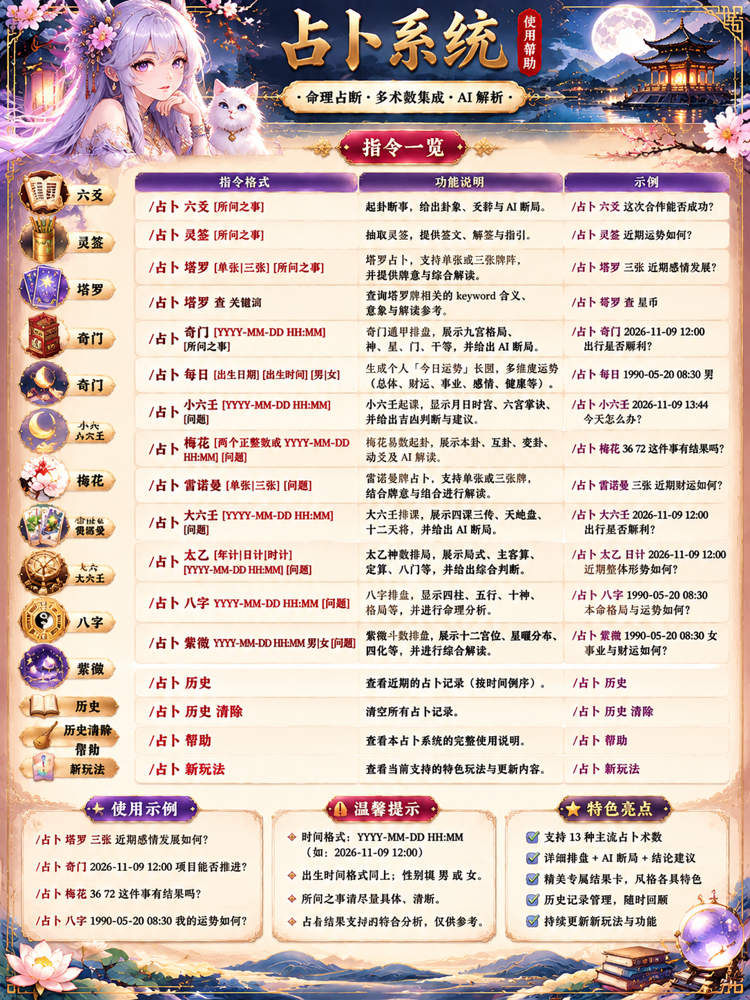
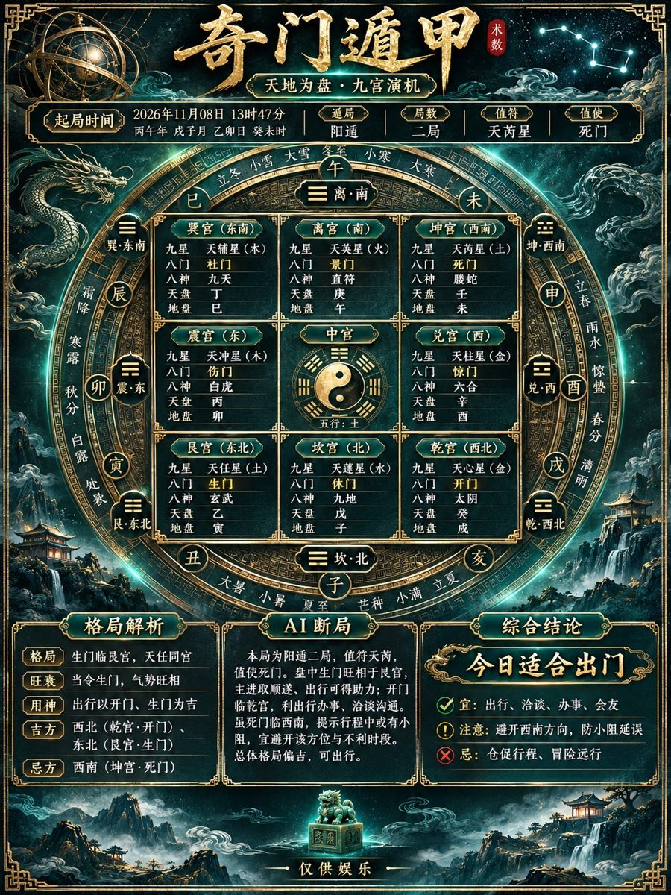
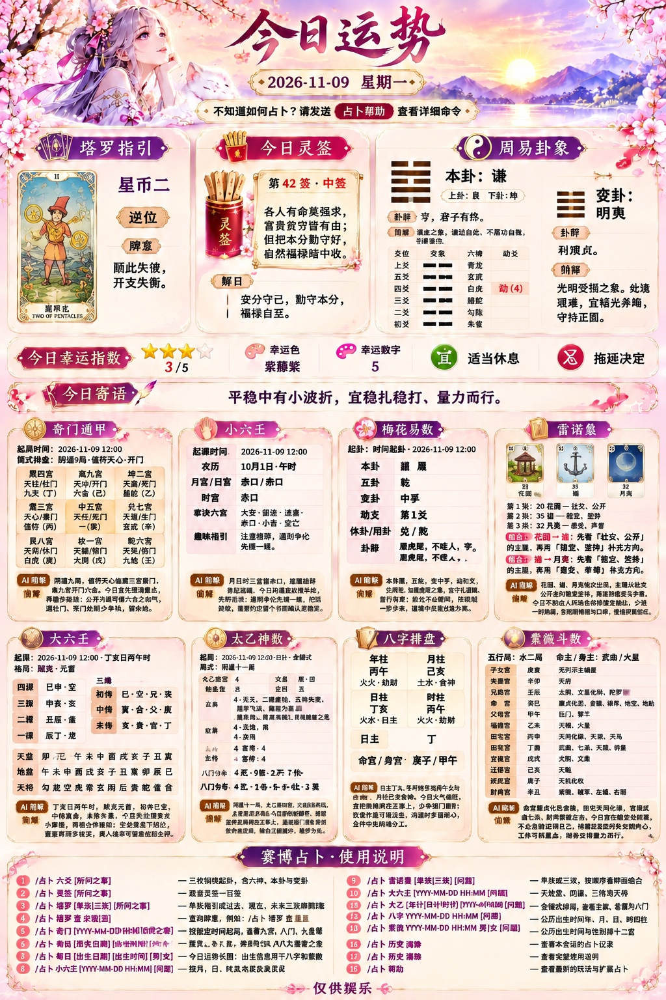
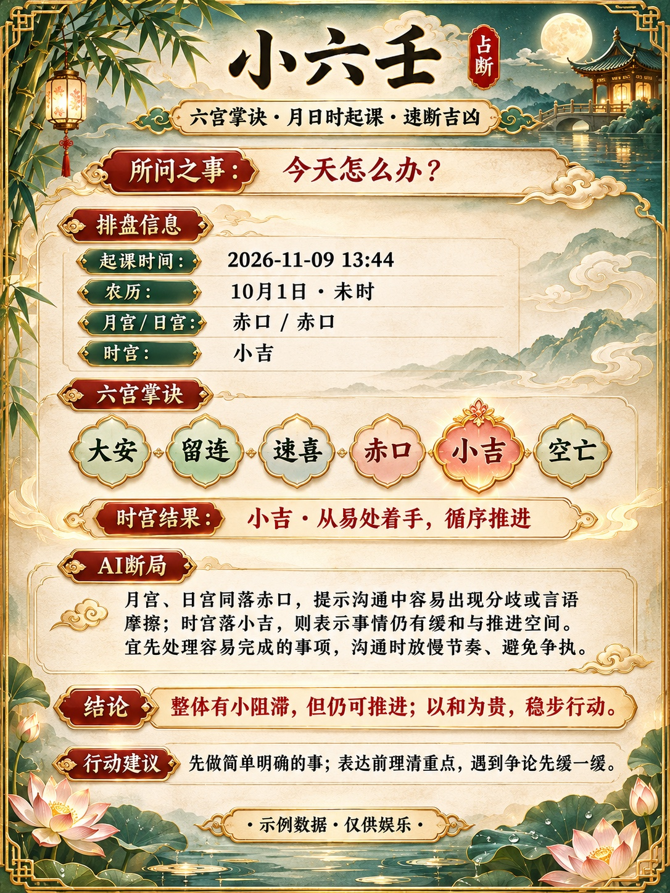
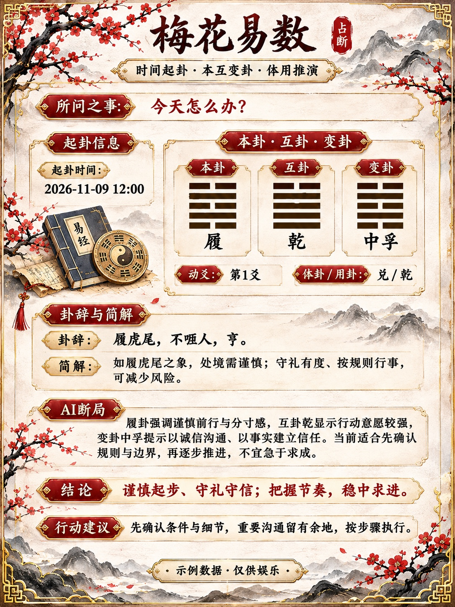
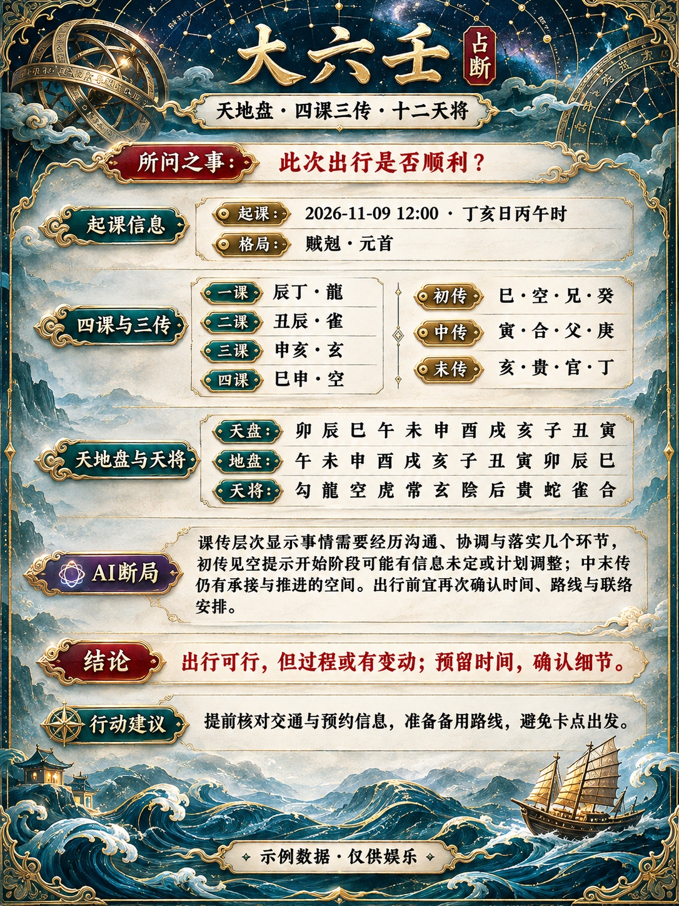
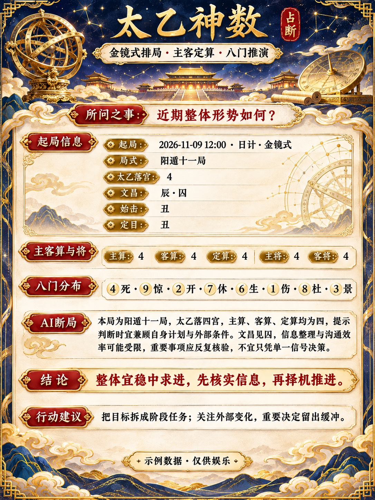
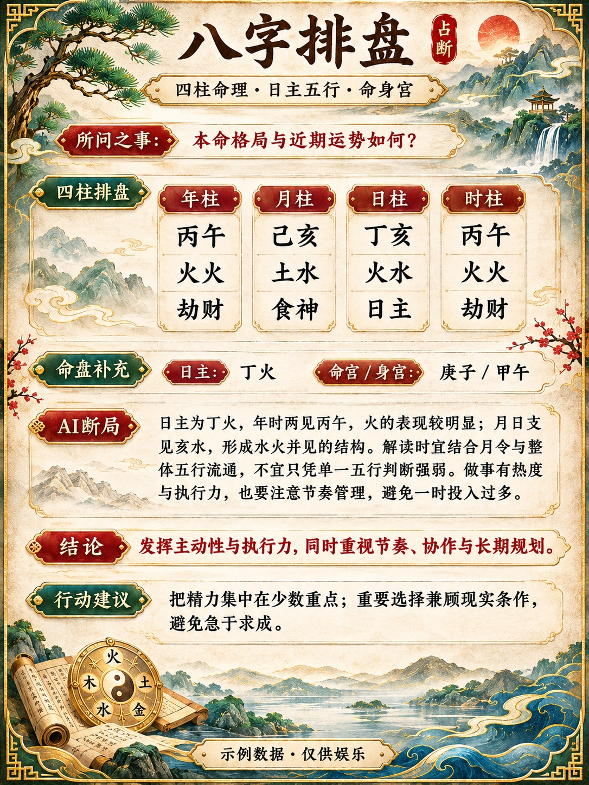
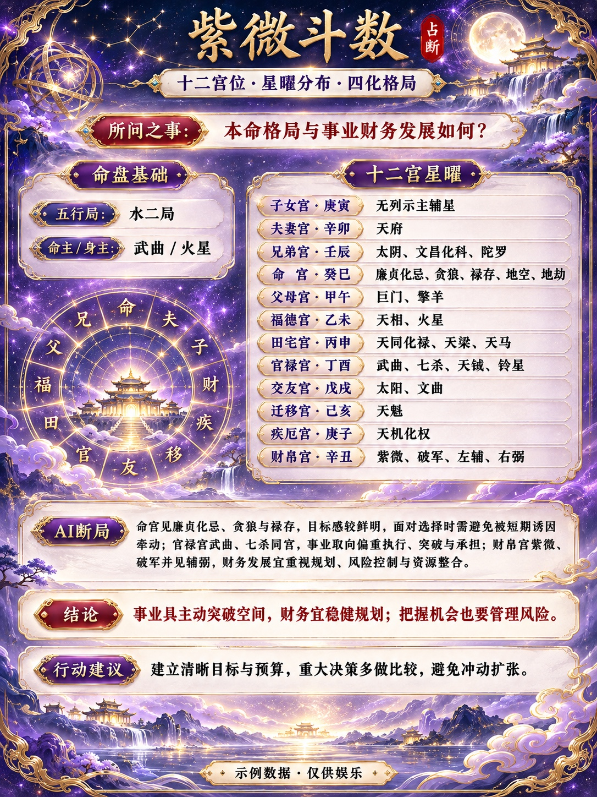

## 🐟 AI 养鱼交流群

**QQ群 1128592290**

欢迎扫码进群，交流 AI 玩法、AstrBot 插件和使用心得。

<a href="docs/qq-group.jpg"></a>

---

# 🔮 赛博占卜 · 多主题卡片 V0.2.0

> 周易六爻、观音灵签、塔罗牌、奇门遁甲、每日运势 —— 传统占卜体系的赛博娱乐实现。

适用于 AstrBot 4.9.2 及以上。支持无前缀关键词、多主题 HTML 卡片、可配置的 AI 绘图 API，以及可选 LLM 润色。默认发送纯文本，开启图片后可以选择 HTML 或 AI。

---

[查看更新日志](CHANGELOG.md)

## 0.2.0 功能与图片预览

- **两种图片输出**。HTML 按本次占卜数据排版；AI 模式可使用自定义绘图节点。AI 失败时尝试 HTML，两者均失败时发送文本。
- **十二套提示词和参考图**。按占卜类型选用内置参考图，并把它与可编辑提示词、当次占卜数据一起送给绘图节点。
- **每日运势长图**。汇总 11 项占卜与排盘，八个扩展区块各有独立简解。
- **生图限额**。可设置单人每日上限与 UMO 白名单、黑名单。
- **群聊回复**。占卜结果引用触发消息并艾特发起人，图片和文本使用相同方式。
- **图文帮助**。发送 `占卜帮助` 或 `/占卜 帮助`，直接收到下面这张使用说明。

<a href="assets/help.png"></a>

### 十二套 AI 绘图参考图

以下图片随插件安装，点击可查看大图。图里的签号、卦名等是视觉示例，实际请求使用本次占卜数据。

| 周易六爻 · 玄墨鎏金 | 观音灵签 · 莲华古卷 | 塔罗 · 星辉秘境 |
| --- | --- | --- |
| <a href="references/zhouyi.jpg"></a> | <a href="references/lingqian.jpg"></a> | <a href="references/tarot.jpg"></a> |

| 奇门遁甲 · 九宫天机 | 每日运势 · 晨曦花笺 |
| --- | --- |
| <a href="references/qimen.jpg"></a> | <a href="references/daily.jpg"></a> |

| 小六壬 | 梅花易数 | 雷诺曼 |
| --- | --- | --- |
| <a href="references/xiaoliuren.jpg"></a> | <a href="references/meihua.jpg"></a> | <a href="references/lenormand.jpg"></a> |

| 大六壬 | 太乙神数 | 八字排盘 | 紫微斗数 |
| --- | --- | --- | --- |
| <a href="references/daliuren.jpg"></a> | <a href="references/taiyi.jpg"></a> | <a href="references/bazi.jpg"></a> | <a href="references/ziwei.jpg"></a> |

## 上游与维护

本项目是独立发布和维护的 AstrBot 插件，基于 ruoyuxian20-sys（若雨希安）的赛博占卜插件开发，并加入多主题卡片、绘图 API、参考图、帮助图与群聊回复。感谢上游作者，保留原作者署名及 MIT 许可。[上游仓库](https://github.com/ruoyuxian20-sys/astrbot_plugin_cyber_divination) · [MIT License](LICENSE)

## ✨ 功能一览

| 功能 | 说明 |
| --- | --- |
| 🪙 周易六爻 | 三枚铜钱起卦，含**按日干布列的六神**、本卦/变卦、卦辞与简解 |
| 📜 观音灵签 | 一百签，吉凶 + 签诗 + 解曰，并统计**今日求签次数**（按天重置） |
| 🎴 塔罗牌 | 单张指引或「过去 · 现在 · 未来」三张牌阵（**无放回抽牌**，不重复）；支持**查牌**看正逆位牌意 |
| 🧭 奇门遁甲 | 简式时家排盘：四柱、用局、值符值使、九宫盘；**不填时间自动检测当前时刻起局**，也可指定时间或中文日期 |
| 🌅 每日运势 | 每日多术排盘长图，按日期和用户生成；可附出生资料查看个人命盘 |
| 🗂️ 占卜历史 | 本会话占卜记录（类型 + 摘要 + 时间），可查看与清除 |
| 🤖 可选 LLM 润色 | 调用当前会话模型生成个性化解读，带超时、冷却与**失败退避**，任何失败自动回退内置解读 |
| 🖼️ 图文卡片 | HTML + CSS + 内嵌 SVG，或通过自定义 API 生成十二种主题的图文卡片 |

## 🚀 安装

**推荐：在 AstrBot 插件管理后台上传 ZIP 安装。** 安装包以一个插件目录为外层，内含 `metadata.yaml`、`main.py`、`_conf_schema.json`、`requirements.txt` 及完整卡片资源。同一插件标识的后续升级可使用与现有插件目录同名的 ZIP。

也可以在 AstrBot 插件管理中使用本仓库地址安装。手动安装时，将插件文件解压到 `data/plugins/astrbot_plugin_cyber_divination_cards/` 并重新加载。

本项目的市场标识为 `DumKing/astrbot_plugin_cyber_divination_cards`。如果曾安装使用 `cyber_divination` 标识的插件，建议先停用它以避免命令冲突，再安装本项目。配置需在本插件中填写，历史记录各自保存。

## 📖 使用

默认唤醒前缀为 `/`：

| 命令 | 说明 |
| --- | --- |
| `/占卜 六爻 [所问之事]` | 铜钱起卦，含六神与本卦变卦 |
| `/占卜 灵签 [所问之事]` | 观音灵签求签 |
| `/占卜 塔罗 [单张\|三张] [所问之事]` | 单张指引或过去/现在/未来牌阵 |
| `/占卜 塔罗 查 [关键词]` | 查询塔罗牌正逆位牌意 |
| `/占卜 奇门 [所问之事]` | 奇门排盘，**自动使用当前时刻** |
| `/占卜 奇门 [时间] [所问之事]` | 指定时刻起局（可推算特定时辰） |
| `/占卜 每日 [出生日期 时间 男\|女]` | 今日运势长图；带出生资料时加入八字与紫微 |
| `/占卜 历史 [清除]` | 查看历史；清除时也清掉发起人的今日运势图片缓存 |
| `/占卜 帮助` 或 `占卜帮助` | 发送内置帮助图片 |
| `/占卜 新玩法` | 查看七种扩展排盘的用法 |

示例：

```text
/占卜 六爻 明天适合出门吗
/占卜 塔罗 三张 感情运
/占卜 塔罗 查 星星
/占卜 奇门 出行吉凶
/占卜 奇门 2026-08-01 15:30 签约是否顺利
/占卜 奇门 2026年8月1日 15:30 出行   ← 支持中文日期
/占卜 每日
/占卜 历史
```

**奇门时间说明**：不填时间时自动检测当前时刻并标注「自动检测当前时刻起局」；支持
`YYYY-MM-DD HH:MM`、`YYYY/MM/DD` 与中文日期 `2026年8月1日 15:30`；仅给日期时按当日正午起局；
时间格式无法识别时提示并回退当前时刻。写「现在 / now」等同自动取当前。

英文命令 `/divine zhouyi` 等同理；子命令均支持中文别名（六爻、周易、灵签、塔罗、奇门、每日、历史等）。
直接发送 `/占卜` 会由框架显示指令树。

占卜结果会引用触发消息，并在群聊艾特发送者。私聊保留引用。AI、HTML 和纯文本共用此回复方式；引用和艾特的显示取决于消息平台。

### 今日运势长图

`/占卜 每日` 展示塔罗、观音灵签、周易六爻、奇门遁甲、小六壬、梅花易数、雷诺曼、大六壬及太乙神数。需要时间的排盘统一以服务器当天正午计算。使用 NapCat 时会尝试读取发起人的 QQ 生日和性别。缺少生日时使用服务器当天日期，缺少出生时间时使用 12:00。紫微优先使用手填性别，其次使用 QQ 资料性别，两者都缺失时按男排盘。补发 `/占卜 每日 08:30` 可覆盖默认时刻，必要时可再附上 男 或 女。要覆盖资料或默认值，可发送 `/占卜 每日 2000-08-16 12:00 女` 手动补齐。带出生资料的长图不复用普通每日运势缓存。

HTML 模式会按内容增加图片高度。AI 模式可在 `ai_daily_image_size` 单独填写节点支持的长图尺寸，例如 `1024x3072`；设计目标为 `3840x21333`，需节点明确支持才填写该尺寸。每日 AI 请求使用 PNG，留空时由节点决定尺寸。实际尺寸和文字效果取决于模型。开启 `llm_enabled` 后，插件用一次调用生成八段独立简解。HTML 仅展示成功生成的简解，AI 绘图模式在没有单独简解时按原始排盘生成。长图底部与帮助图片均包含新增玩法命令。

### 七种新增玩法

发送 `/占卜 新玩法` 可查看速查表。开启关键词触发后，可用玩法名直接唤醒；带参数时用开头匹配。

| 玩法 | 示例 | 排盘范围 |
| --- | --- | --- |
| 小六壬 | `/占卜 小六壬 今天出行怎么样` | 月、日、时逐宫起课，显示大安等六宫与简短指引 |
| 梅花易数 | `/占卜 梅花 23 57 最近工作怎么样` | 双数起卦或按时间起卦，展示本卦、互卦、变卦、动爻和体用 |
| 雷诺曼 | `/占卜 雷诺曼 三张 这件事接下来如何` | 36 张牌中不重复抽取，支持单张、三张和相邻牌关键词组合 |
| 大六壬 | `/占卜 大六壬 2026-11-09 12:00 出行` | 天地盘、四课、三传、天将和课体格局 |
| 太乙神数 | `/占卜 太乙 日计 2026-11-09 12:00` | 金镜式年计、日计、时计，展示局式、主客算和八门 |
| 八字 | `/占卜 八字 2000-08-16 12:00 [问题]` | 公历出生时间排四柱、五行、十神及命身宫 |
| 紫微斗数 | `/占卜 紫微 2000-08-16 12:00 女 [问题]` | 公历出生时间和排盘性别，展示十二宫、主辅星及四化 |

小六壬、梅花、大六壬和太乙可省略起局时间，默认使用 AstrBot 服务器当前时间。八字和紫微接受 1901–2099 年的公历当地钟表时间，未作出生地或真太阳时修正。出生日期和时间原文不会放进 AI 绘图请求，命盘数据会随绘图请求发送。依赖通过 `requirements.txt` 安装。

新增玩法提供 HTML 卡片和独立的可编辑 AI 提示词。已配置 `ai_image_reference_endpoint` 时会上传该玩法的内置参考图；留空时使用 `ai_image_endpoint` 文生图。历史、回复引用和生图限额沿用原有规则。

排盘库与规则参考：[lunar-python](https://github.com/6tail/lunar-python)、[kinliuren](https://github.com/kentang2017/kinliuren)、[kintaiyi](https://github.com/kentang2017/kintaiyi)、[iztro-py](https://github.com/spyfree/iztro-py)、[玄机排盘](https://github.com/GaoRenYouShu/XuanJiPaiPan)、[梅花排盘](https://github.com/ChuCi013/paipan)。太乙使用已验证的上游固定版本；雷诺曼使用插件自写的简短牌意。

### 关键词触发

开启 `keyword_trigger_enabled`，可直接发送「塔罗」「求灵签」「奇门遁甲」「六爻」「每日运势」。在 `keyword_aliases` 中可分别编辑关键词，空列表禁用对应功能的关键词触发。固定命令「占卜帮助」也可直接发送，关闭关键词触发时仍可使用。

`keyword_trigger_mode` 支持完全匹配 `exact`、开头匹配 `starts_with` 和包含匹配 `contains`。后两种会将关键词后的文字交给原命令，例如「塔罗 三张 最近的状态怎么样」。带唤醒前缀的消息由原命令处理。

## ⚙️ 配置（Dashboard 插件设置）

| 配置项 | 默认 | 说明 |
| --- | --- | --- |
| `llm_enabled` | `false` | 是否启用 LLM 润色解读。开启后调用当前会话模型生成个性化解读 |
| `llm_cooldown_seconds` | `300` | 每个会话两次 LLM 调用的最小间隔（秒），防止频繁调用 |
| `llm_timeout_seconds` | `30` | 单次 LLM 调用超时（秒），超时自动回退内置解读 |
| `history_max` | `10` | 每个会话保留的占卜历史条数上限（1-50） |
| `use_image` | `false` | 占卜结果出图开关。关闭时发送文本，帮助命令仍发送内置图片 |
| `image_mode` | `html` | `html` 只用 AstrBot HTML 渲染，`ai` 优先调用绘图 API |
| `card_theme` | `auto` | `auto`：五套主题自动切换；`gold`：五种排版保留、切换统一黑金配色 |
| `card_hd` | `true` | 使用高分辨率 PNG（约 1.3 倍像素），耗时和文件体积略增 |


### 出图前确认

| 配置项 | 默认 | 说明 |
| --- | --- | --- |
| `image_ack_reaction_enabled` | `true` | 给触发消息贴 QQ 的 OK 表情，需 NapCat 或兼容 OneBot 表情接口 |
| `image_ack_text_enabled` | `false` | 出图前另发一条确认消息 |
| `image_ack_text` | 收到收到，正在为你生成{title}卡片，请稍等～ | `{title}` 自动替换为占卜名称，留空时不发确认文字 |

开启图片输出后，插件在 HTML 渲染或 AI 出图前发送确认。帮助、查牌、历史、纯文本占卜及命中图片缓存的每日运势直接回复结果。确认发送失败或超时，插件会继续占卜。

### AI 绘图 API

设置 `use_image=true`、`image_mode=ai`，然后填写下表。切回 `image_mode=html` 即关闭 AI 调用。本项目的默认图片模式为 HTML。

| 配置项 | 默认 | 说明 |
| --- | --- | --- |
| `ai_image_endpoint` | 空 | 完整的 HTTP(S) POST 地址，例如 `https://api.example.com/v1/images/generations`。支持填内网节点 |
| `ai_image_model` | 空 | 节点要求的模型名 |
| `ai_image_api_key` | 空 | API 密钥。管理界面遮蔽显示，无需鉴权的节点留空 |
| `ai_image_auth_header` | `bearer` | `bearer` 发送 `Authorization: Bearer …`，`api-key` 发送 `api-key` 请求头 |
| `ai_image_size` | 空 | 节点支持的尺寸，例如 `1024x1536`。留空使用服务默认值，提示词仍引导接近 3:4 的构图 |
| `ai_image_download_origin` | 空 | URL 图片默认只下载同源地址。若节点返回独立 CDN 地址，填如 `https://cdn.example.com` |
| `ai_image_include_question` | `false` | 开启后将问题原文交给绘图节点排版为「所问之事」 |
| `ai_image_daily_limit_enabled` | `false` | 限额总开关；关闭时所有会话均不限 |
| `ai_image_daily_limit` | `0` | 每个发送者每天可发起的 AI 生图次数，0 为不限。达到上限后回退到 HTML |
| `ai_image_umo_whitelist` | `[]` | 完整 UMO 白名单，命中后不限次数 |
| `ai_image_umo_blacklist` | `[]` | 完整 UMO 黑名单，只命中黑名单时直接回退 HTML |
| `ai_image_umo_default` | `limited` | 两份名单均未命中时的规则；`limited` 为限额，`unlimited` 为不限 |
| `ai_image_timeout_seconds` | `180` | 单次请求、下载及图片验证的总超时，限制为 1–600 秒 |
| `ai_prompt_zhouyi` / `ai_prompt_lingqian` / `ai_prompt_tarot` / `ai_prompt_qimen` / `ai_prompt_daily` | 五个基础主题的默认提示词 | 可在后台逐套编辑。清空使用默认；插件自动追加本次结果的 JSON |

文生图和参考图出图请求均发送 `quality=high`。节点须支持该质量值并同步返回最终图片。请求为 JSON，例如 `{"model":"your-model","prompt":"…","n":1,"size":"1024x1536"}`。支持 [OpenAI Images 生成接口](https://developers.openai.com/api/reference/resources/images/methods/generate) 的 `data[0].b64_json` 或 `data[0].url`，也支持直接返回 PNG、JPEG、WebP。异步任务 ID 需要由节点网关转换成同步响应。图片限 10 MiB、单帧；通常限 1600 万像素，明确请求 `3840x21333` 的每日 PNG 长图时按该尺寸上限校验。API 和下载均禁止重定向，下载请求不携带 API 密钥。

七种扩展玩法同样有独立的 `ai_prompt_*` 配置。五个基础主题沿用玄墨鎏金、莲华古卷、星辉秘境、九宫天机和晨曦花笺，并分别详细指定背景、标题、主体信息、下部区块和字体。升级时会使用新版默认提示词，之前手动编辑过的提示词会保留。动态字段来自实际起卦、抽签和排盘结果。发给绘图节点的是版式提示和占卜字段，默认不含提问正文；打开 `ai_image_include_question` 后会将问题原文发给绘图节点。用户昵称、用户 ID 和 LLM 润色文本不随绘图请求发送。奇门的起局时刻会随排盘字段发送。AI 卡片中的汉字、爻线或宫位可能出现模型误差。AI 和 HTML 出图成功时均只发送图片。

API 超时、鉴权失败、无效响应或图片下载失败时，用**同一次占卜结果**渲染 HTML。HTML 失败则发送原文。每次占卜最多请求一次绘图 API。每日运势在同一插件进程内按服务器日期和发送者 ID 缓存成功的 AI 图片，同一用户当天重复查询会复用图片。无发送者 ID 或生图失败时不写入缓存。重载或重启插件会清空缓存；缓存满时优先淘汰最久未使用的图片。

生图额度按服务器日期和发送者 ID 统计，同一发送者在受限会话中共用额度。没有发送者 ID 时按 UMO 统计。额度保存在插件数据中，重启仍有效。每次尝试调用绘图节点前扣一次，失败也计入；每日运势图片缓存命中、HTML 出图和免限会话均不扣次数。填入群聊 UMO 会对该群所有成员应用所选规则，填入私聊 UMO 则仅对该私聊生效。两份名单可同时填写，按完整 UMO 精确匹配。总开关开启时，白名单优先；只命中黑名单时直接回退 HTML，不调用绘图节点，也不复用 AI 图片缓存。两份名单均未命中时，按默认规则判断是否限额。每日上限为 0 时不限制次数，但黑名单仍生效。

### 带参考图出图

1. 设置 `use_image=true`、`image_mode=ai`，填写支持图像输入的模型与鉴权。
2. 在 `ai_image_reference_endpoint` 填支持上传图片的完整编辑地址，例如 `https://api.example.com/v1/images/edits`。开启后，插件在这个地址发送一张参考图、主题提示词和本次占卜数据。留空时使用原有纯文字绘图地址。
3. 插件目录中的 `references/` 内置 12 张 JPEG 参考图，涵盖五个原有主题和七种新增玩法。插件按玩法选择对应图片并随请求上传给配置的服务。
4. 接口须支持 [Images Edits 的 multipart 请求](https://developers.openai.com/api/reference/resources/images/methods/edit)。上传字段默认 `image[]`，兼容使用单字段的节点可将 `ai_image_reference_field` 改为 `image`。沿用原有模型、API 密钥、尺寸和超时设置。

参考图仅指导版式、字体、配色与装饰，卡片数据以插件本次结果为准。缺少参考图或接口失败时沿用 HTML → 文本回退。出图成功只发送图片。

## 🖼️ 五套 HTML 卡片主题

HTML 模式使用五套独立布局和 SVG 装饰，按占卜命令自动选择。

| 占卜 | 视觉主题 | 动态展示的数据 |
| --- | --- | --- |
| 六爻 | 玄黑鎏金 · 梅花、八卦、山水亭台、书法标题 | 原始 `ZhouyiCast` 六爻值、六神、动爻、本卦/变卦、卦辞、简解和 AI 解读 |
| 灵签 | 莲华古卷 · 米白宣纸、朱砂印、签诗 | 签号、签级、完整签诗、解曰、AI 解签 |
| 塔罗 | 星辉秘境 · 紫金花纹、月相、独立拱形牌面 | 单张/三张牌的真实名称、正逆位与牌意（**插画为抽象原创图案，不是原始牌面照片**） |
| 奇门 | 九宫天机 · 深青玉青铜、罗盘与 3×3 九宫 | 原项目 `make_pan` 真实九宫数据、时刻、四柱、遁局、值符值使、解析与 AI 解读 |
| 每日 | 晨曦花笺 · 奶油白、樱花日签 | 当天确定性的塔罗、灵签、周易及综合建议；另加明确标注的趣味幸运指数/颜色/数字/宜忌 |

具体说明：

- HTML 直接排版插件计算的数据。AI 模式会把数据交给绘图模型，图中文字和卦象可能出现误差。
- 通过 AstrBot `self.html_render(..., options={"type":"png", "full_page":True, ...})` 渲染，发送 `event.image_result(url)`。
- 所有装饰性 SVG 和 CSS 都已内嵌到 HTML 中，不访问外部图片服务器。
- 默认 900 CSS 像素宽、自动适应高度，`card_hd=true` 时使用高清 DPI。
- HTML 渲染失败时发送本次占卜原文。
- 历史查询和塔罗查牌使用文本回复。帮助命令直接发送内置帮助图，图片缺失时回退到文字说明。

### 字体与 Ubuntu / Docker

字体由**实际运行截图的 AstrBot/T2I 容器**提供，不是 QQ 客户端字体。为了让中文书法标题与正文正常显示，建议截图容器安装：

```bash
# Debian / Ubuntu 容器内（不是只在主机安装）
apt-get update
apt-get install -y fonts-noto-cjk fonts-arphic-kai fontconfig
fc-cache -f
fc-match 'Noto Serif CJK SC'
fc-match 'Noto Sans CJK SC'
fc-match 'AR PL KaitiM GB'
```

- **六爻、灵签**：标题优先楷体/书法风格（`AR PL KaitiM GB` / `STKaiti`），正文优先 `Noto Serif CJK SC`。
- **塔罗**：英文以典雅衬线字体为主，中文使用宋体，牌名加粗。
- **奇门**：标题楷体，宫位数字/数据以清晰字体渲染。
- **每日**：清新手写风格标题，正文 `Noto Sans CJK SC`。
- 未找到某个字体时，CSS 会自动使用替代字体；插件**没有附带任何字体文件**。

### 安装后验证

1. 发 `占卜帮助` 检查帮助图，再发 `/占卜 六爻 今天适合出门吗` 检查基础命令。
2. 测试 HTML 时，设置 `use_image=true`、`image_mode=html`，再发一次占卜命令。
3. 测试 AI 时，设置 `image_mode=ai` 并填写节点配置。看到 HTML 卡片时，在日志里查找 `cyber_divination API 生图失败`。如果回退到了文本，再查找 `cyber_divination HTML 渲染失败`。

## 🧠 设计说明

- **随机性**：起卦/抽牌/抽签使用系统安全随机源；测试可注入固定种子。塔罗三张牌阵无放回，不会重复。
- **每日运势确定性**：以（日期, 用户 ID）的 MD5 摘要作种子，同一天同一人结果固定，跨进程一致。
- **历史记录**：按会话存于插件 KV，超过 `history_max` 丢弃最旧记录，可随时清除。
- **稳定性**：LLM 默认关闭；带超时与冷却，调用失败后 60 秒内直接回退内置解读，不会卡满超时；所有 KV/渲染失败均静默降级，不影响主流程。
- **安全渲染**：图文卡片对用户输入做 HTML 转义，问题文本中的特殊字符不会破坏卡片。

## ❓ 常见问题

- **为什么每日运势看起来一样？** 同一账号在同一服务器日期内结果固定。不同账号各自抽取，部分结果可能碰巧相同。消息适配器无法提供发送者 ID 时，同一会话会共用一份结果。AI 卡片也可能照搬参考图上的示例内容，可切换 HTML 或文本检查当次数据。
- **奇门排盘和网上的工具对不上？** 本插件为**简式时家排盘**：节气日期近似、未处理超接置闰，天盘/八门/八神按九宫数字序顺逆飞布（神盘不入中五，中五寄坤二），结果仅供娱乐参考。
- **灵签签文和我见过的版本不一样？** 签文为民间通行整理版，不同版本可能存在异文。
- **开了 LLM 润色但没生效？** 检查是否处于冷却期；LLM 服务不可用时会在 60 秒内静默回退内置解读。

## ⚠️ 免责声明

本项目所有占卜内容仅供娱乐，不构成任何决策建议，请理性看待。

## 🧪 开发

测试可脱离 AstrBot 运行。在仓库根目录执行：

```bash
python -m pip install -r requirements.txt pytest
python -m pytest tests
```

`ruff.toml` 说明：主插件对 AstrBot 各版本 API 差异做防御式捕获与静默降级（有意为之）；干支/节气按本地天真时间计算，DTZ 类规则不适用。

## 📄 License

[MIT](LICENSE)
